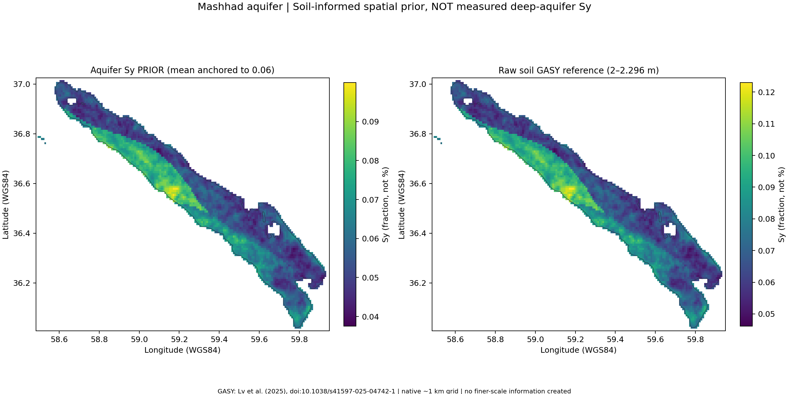
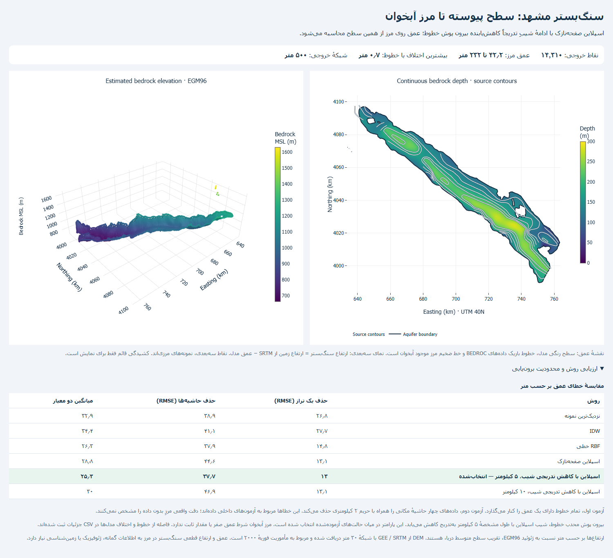

# گزارش منابع، روش‌ها و فرضیات مدل آب زیرزمینی

**تمرکز: آبدهی ویژه (Sy)، سنگ‌کف، تغییر ذخیره و نمایش‌های سه‌بعدی**

سامانهٔ پایش تراز آب زیرزمینی | مشهد، نیشابور و سناریوی کرات

تاریخ گزارش: **۲۱ آبان ۱۴۰۵ / ۱۲ نوامبر ۲۰۲۶** · نسخهٔ گزارش: **۱٫۰**

این گزارش وضعیت فایل‌ها و کد موجود در پروژه را مستند می‌کند. تهیهٔ گزارش به معنای اجرای کالیبراسیون جدید، اخذ دادهٔ صحرایی جدید یا تأیید صحت زمین‌شناسی مدل نیست. نسخهٔ متنی همین گزارش مبنای خروجی PDF است.

## ۱. خلاصهٔ مدیریتی و حدود اعتبار

سه لایهٔ متفاوت در این پروژه کنار هم قرار گرفته‌اند: داده‌های ارائه‌شدهٔ پیزومترها و مرزها؛ برآوردهای محاسباتیِ سطح آب، سنگ‌کف و پارامتر ذخیره؛ و هندسه‌ای که صرفاً برای نمایش سه‌بعدی تغییر می‌کند. این سه لایه نباید به‌جای یکدیگر تفسیر شوند.

| موضوع | آنچه در نسخهٔ فعلی استفاده می‌شود | آنچه از آن قابل نتیجه‌گیری نیست |
|---|---|---|
| سطح آب | عمق مشاهده‌شده و تراز زمین چاه؛ درون‌یابی مکانی | مشاهدهٔ مستقیم سطح آب در همهٔ پیکسل‌ها |
| سنگ‌کف مشهد | خطوط عمق ارائه‌شده، سطح پیوستهٔ برآوردی و SRTM | ژئوفیزیک یا عمق اندازه‌گیری‌شده در سراسر مرز |
| سنگ‌کف نیشابور | رقومی‌سازی تقریبی شکل S4 و اصلاح مرزیِ فرضی | برداشت مستقیم همهٔ نقاط خروجی از مقاله |
| Sy مکانی مشهد | پیش‌برآورد خاک‌مبنا از GASY؛ تنظیم میانگین روی ۰٫۰۶ | نقشهٔ Sy عمقی حاصل از آزمایش پمپاژ |
| حجم باقی‌مانده | برآورد حجم معادلِ قابل زهکشی با Sy انتخابی | کل آب منفذی یا حجم تضمین‌شدهٔ قابل برداشت |
| بخش قرمز | کاهش مثبت ذخیره یا افت، بسته به نوع نما | مصرف خالص یا برداشت ناخالص از چاه‌ها |
| کناره‌های بالا‌آمده | هندسهٔ نمایشی متصل به سطح مبنا | تغییر واقعی سنگ‌کف یا مرز زمین‌شناسی |

**نتیجهٔ کلیدی:** خروجی‌ها برای تحلیل سناریو، مقایسهٔ دو دوره و معرفی مکانی تغییرات مناسب‌اند. برای تصمیم کمی دربارهٔ ذخیره یا بهره‌برداری، کنترل مبنای ارتفاعی، کالیبراسیون Sy و تأیید سنگ‌کف، به‌ویژه در حاشیه‌ها، ضروری است.

گزارش دربارهٔ اجرای فعلی است؛ گزینه‌های انتخابی کاربر، فایل سنگ‌کف جایگزین و فایل Sy مکانی می‌توانند نتیجه را تغییر دهند. وجود یک روش در کد نیز به معنای انتخاب یا اجرای آن در همهٔ تحلیل‌ها نیست.

## ۲. داده‌های پایه، واحدها و تقویم

### ۲٫۱. دفتر داده‌ها

| داده | مسیر اصلی | متغیر و نقش | وضعیت منشأ |
|---|---|---|---|
| مرز آبخوان | `Data/AQUIFER.geojson` | محدوده، اجزای چندپاره و حفره‌ها | فایل پروژه؛ مرز لزوماً رخنمون سنگ‌کف نیست |
| محدودهٔ مطالعاتی | `Data/MAHDOUDE.geojson` | تطبیق مکانی و انتخاب ایستگاه‌های بارش | مستقل از مرز آبخوان |
| مشخصات چاه | `Data/LOCATION.csv` | X، Y، نام و `LEVEL_MSL` | مبنای برداشت ارتفاع باید جدا کنترل شود |
| مشاهدات آب | `Data/DATA.csv` | `WATER_TABLE` و تاریخ شمسی | عمق آب از سطح زمین، بر حسب متر |
| سنگ‌کف مشهد | `Data/MASHHAD_BEDROCK_MSL.csv` | تراز کف نسبت به مرجع EGM96 | خروجی برآوردی از خطوط عمق و DEM |
| سنگ‌کف نیشابور | `Data/NEYSHABUR_BEDROCK_DEPTH.csv` | عمق، مقدار منبع، نقش نقطه و فرض مرزی | ترکیب رقومی‌سازی و مدل هندسی |
| Sy مکانی مشهد | `Data/MASHHAD_SY/` | رستر، CSV، Audit و Metadata | پیش‌برآورد خاک‌مبنا، بدون کالیبراسیون پمپاژ |

برای دو فایل پایهٔ چاه و مشاهدات، صرف وجود نام متغیرها به معنای تأیید مستقل سازمان تولیدکننده، دقت ابزار، تاریخ ترازیابی یا مبنای ارتفاعی نیست. این اطلاعات باید از شناسنامهٔ اولیهٔ داده‌ها تکمیل شود؛ در این گزارش برای آن‌ها منشأ صحراییِ تأییدنشده اختراع نشده است.

### ۲٫۲. تبدیل عمق به تراز

در صفحهٔ سه‌بعدی، فرض می‌شود `WATER_TABLE` عمق مثبت رو به پایین از تراز زمین همان چاه است:

```text
h = LEVEL_MSL - WATER_TABLE
```

در این رابطه، `h` تراز آب و هر دو ورودی بر حسب مترند. اگر یک فایل، ارتفاع آب را به‌جای عمق در `WATER_TABLE` ذخیره کرده باشد، این تبدیل نادرست می‌شود. هم‌نام‌سازی محدوده، آبخوان و پیزومتر برای اتصال جدول‌ها انجام می‌شود؛ نویسه‌های عربی/فارسی و فاصله‌ها یکسان می‌شوند.

در ماژول سه‌بعدی، چند مشاهدهٔ معتبر یک پیزومتر در یک ماه با میانگین عمق ماهانه تجمیع می‌شوند. رکورد غیرعددی یا ماه نامعتبر وارد محاسبه نمی‌شود. تعداد اعشار فایل‌ها دقت واقعی ابزار یا ارتفاع‌برداری را تضمین نمی‌کند.

### ۲٫۳. قرارداد سال آبی

سال آبی ایران از **۱ مهر تا پایان شهریور سال بعد** است و با سال شروع نام‌گذاری می‌شود:

```text
WY(y) = Mehr(y) ... Shahrivar(y+1)
water_year = year          if Persian month >= 7
water_year = year - 1      if Persian month <= 6
```

بنابراین شهریور ۱۴۰۴ در **WY ۱۴۰۳** قرار می‌گیرد. تاریخ میلادیِ انتشار منابع یا تهیهٔ این گزارش، واحد تجمیع هیدرولوژیک نیست. فصل‌ها نیز پاییز مهر تا آذر، زمستان دی تا اسفند، بهار فروردین تا خرداد و تابستان تیر تا شهریورند.

## ۳. تعریف پارامتر ذخیره و مقادیر پیش‌فرض

### ۳٫۱. تمایز Sy، تخلخل و ضریب ذخیره

Sy یا آبدهی ویژه، نسبت حجم آب آزادشده با زهکشی ثقلی به حجم کل محیط است و بی‌بُعد گزارش می‌شود. تخلخل، کل فضای خالی را بیان می‌کند؛ همهٔ آب منفذی با زهکشی ثقلی آزاد نمی‌شود. ضریب ذخیرهٔ آبخوان تحت فشار نیز به تراکم‌پذیری آب و اسکلت محیط مربوط است. استفادهٔ یکسان از این سه کمیت از نظر فیزیکی موجه نیست [۵].

رابطهٔ زیر برای برآورد تغییر ذخیرهٔ آبخوان آزاد استفاده می‌شود، نه یک مدل کامل جریان:

```text
dV ~= A * Sy * dh
```

این تقریب Sy را در بازهٔ تراز مورد بررسی نماینده فرض می‌کند. تأخیر زهکشی، تغییر بافت در عمق، تراکم برگشت‌ناپذیر و رفتار لایهٔ محصور در این رابطه به‌طور مستقل حل نمی‌شوند.

### ۳٫۲. پیش‌فرض‌های آبخوان‌ها

| آبخوان | مقدار | پشتوانه | فرض افزودهٔ پروژه |
|---|---|---|---|
| مشهد | `0.06` | میانگین منطقه‌ای گزارش‌شده برای مشهد-چناران در Noor et al. (2025) [۱] | ثابت‌گرفتن در پهنه یا استفاده به‌عنوان قید میانگین سناریوی مکانی |
| نیشابور | `0.051` | یزدانی و منصوریان، ۱۳۹۳؛ میانگین ضریب ذخیرهٔ گزارش‌شده از پمپاژ [۴] | به‌کاربردن به‌جای Sy و یکنواخت‌گرفتن در پهنه، هر دو فرض مدل‌اند |
| کرات | `0.12` | میانهٔ دامنهٔ `0.05-0.19` شکل ۷b منبع ثبت‌شده در پروژه [۷] | مقدار یکنواخت، اندازه‌گیری سراسری نیست |
| سایر آبخوان‌ها | ورودی کاربر | باید منبع محلی داشته باشد | ضریب عمومیِ معتبر برای همهٔ آبخوان‌ها تعیین نشده است |

عدد ۰٫۰۶ معادل ۶٪ است؛ ورود عدد ۶ به‌جای ۰٫۰۶ خطاست. ورودی مکانی سه ستون `longitude,latitude,Sy` یا `lon,lat,Sy` می‌پذیرد؛ مقدار باید متناهی و بین صفر و یک باشد. حداقل سه نقطهٔ غیرهم‌خط و پوشش همهٔ مراکز محاسباتی در پوش محدب نقاط لازم است. نقاط تکراری با ضرایب متناقض رد می‌شوند.

منبع نیشابور در متن فارسی ضریب انتقال حدود ۱۰۰۰ مترمربع در روز و ضریب ذخیرهٔ ۰٫۰۵۱ را گزارش می‌کند؛ ترتیب این دو کمیت در چکیدهٔ انگلیسی آشفته است. گزارش حاضر تفسیر متن فارسی و واحدهای فیزیکی را مبنا می‌گیرد، نه تبدیل ضریب انتقال به Sy.

وضعیت دسترسی منابع نیز یکسان نیست: مشخصات و چکیدهٔ نیشابور بررسی شد؛ PDF منبع کرات در بررسی فعلی بازیابی نشد و استناد آن از ثبت قبلی پروژه آمده است. این مورد در فهرست منابع مشخص شده و بازخوانی مستقلِ جدید آن ادعا نمی‌شود.

## ۴. نقشهٔ مکانی Sy مشهد: دادهٔ خاک و سناریوی آبخوان

### ۴٫۱. منبع و علت انتخاب

مجموعهٔ **GASY** توسط Lv و همکاران، بر پایهٔ رابطهٔ بافت خاک با آبدهی ویژه و با استفاده از SoilGrids، GSDE و HWSD منتشر شده است [۲، ۳]. در این پروژه دو لایهٔ عمیق‌ترِ قابل دریافت انتخاب شدند: لایهٔ هفتم SoilGrids در ۲ متر و آخرین لایهٔ فایل دوم GSDE در ۲٫۲۹۶ متر. این‌ها دادهٔ عددی منتشرشده‌اند؛ نقشهٔ حاضر از رنگ‌بندی تصویر مقاله استخراج نشده است.

مقالهٔ محلی Noor و همکاران نقشهٔ Sy نیز دارد، اما تصویر اصلی آن از مسیرهای در دسترس دریافت نشد. بنابراین خروجی حاضر **رقومی‌سازی شکل ۶ آن مقاله نیست**. GEE نیز برای ساخت این نقشهٔ Sy اجرا نشده؛ نقش GEE در این پروژه، از جمله دریافت SRTM مشهد و آماده‌سازی محصولات اقلیمی/پوشش گیاهی، موضوعی جداست.

### ۴٫۲. مراحل ساخت

۱. مرز اصلی مشهد از GeoJSON پروژه خوانده شد؛ مرز یا حفره‌ها برای جورشدن با محصول خاک تغییر نکردند.

۲. فقط بازه‌های بایتیِ ناحیهٔ لازم از فایل‌های جهانی NetCDF دریافت شدند؛ دانلود کل فایل‌های چندگیگابایتی لازم نبود. مشخصات متغیرها، بازه‌های دانلود و هش هر بازه ثبت شد.

۳. آخرین لایهٔ GSDE با نزدیک‌ترین همسایه به شبکهٔ SoilGrids منتقل شد. بیشترین فاصلهٔ تطبیق حدود ۹۰ متر است. این ثبت مجدد، تفکیک داده را بهتر نمی‌کند.

۴. مرجع خامِ همین محصول، میانگین حسابی دو لایهٔ انتخاب‌شده است. این تعریف، میانگین عمقی کل آبخوان یا بازتولید عین تمام نسخه‌های میانگین مقاله نیست:

```text
Sy_soil(i) = [GASY_SoilGrids_2m(i) + GASY_GSDE_2.296m(i)] / 2
```

۵. وزن هر پیکسل، مساحت تقاطع واقعی آن با آبخوان است. برای نسخهٔ سناریویی، میانگین روی ۰٫۰۶ تنظیم شد:

```text
mu_soil = sum[A_intersection(i) * Sy_soil(i)] / sum[A_intersection(i)]
k       = 0.06 / mu_soil
Sy_prior(i) = k * Sy_soil(i)
```

**این تنظیم، قید میانگین است و کالیبراسیون محلی با آزمایش پمپاژ نیست.** حفظ میانگین Sy نیز لزوماً حجم ذخیره را با حالت Sy ثابت برابر نمی‌کند؛ ضخامت اشباع در سطح آبخوان متغیر است.

### ۴٫۳. مشخصات و نتیجهٔ ساخت

| شاخص | مقدار ثبت‌شده |
|---|---|
| مساحت کروی پولیگون | ۲۵۲۶٫۱۹ کیلومتر مربع |
| میانگین خامِ وزنی مساحت | ۰٫۰۷۳۷۹۸۰۵ |
| ضریب مقیاس سناریو | ۰٫۸۱۳۰۲۹۶۳ |
| میانگین سناریو | ۰٫۰۶ |
| دامنهٔ خامِ خاک | ۰٫۰۴۶۱۶۵ تا ۰٫۱۲۲۹۷۳ |
| دامنهٔ پیش‌برآورد | ۰٫۰۳۷۵۳۳ تا ۰٫۰۹۹۹۸۱ |
| تفکیک شبکه | ۱/۱۲۰ درجه؛ اسمی حدود ۱ کیلومتر |
| ابعاد رستر | ۱۲۲ سطر، ۱۷۶ ستون |
| پیکسل دارای تقاطع | ۴۰۱۶ |
| پوشش هر دو منبع | ۱۰۰٪ محدودهٔ تقاطع؛ بدون پرکردن ناحیهٔ فاقد داده |
| میانگین قدرمطلق اختلاف دو منبع | حدود ۰٫۰۳۸۰۲۳؛ حساسیت به منبع، نه خطای اندازه‌گیری معلوم |
| قالب مکانی | EPSG:4326، شمال بالا، PixelIsArea، Float32، NoData برابر ‎−۹۹۹۹ |

در عرض مشهد، ابعاد زمینی سلول حدود ۷۵۰ در ۹۳۰ متر است. شبکه به ۳۰ متر ریز نشده و جزئیات کاذب تولید نشده است. پیکسل‌های دارای تقاطع مثبت با مرز حفظ شده‌اند؛ پیکسل مرزی ممکن است بخشی بیرون پولیگون داشته باشد، ولی آن بخش در میانگینِ مساحت وزن ندارد.



*شکل ۱. سمت چپ پیش‌برآورد با میانگین ۶٪ و سمت راست مرجع خام دو محصول خاک. اعداد کسر بی‌بُعدند، نه درصد. منبع داده: GASY [۲، ۳]؛ پردازش و تنظیم میانگین: پروژهٔ حاضر.*

### ۴٫۴. CSV و سازگاری با داشبورد

CSV اصلی دارای ۴۳۸۰ نقطه با قالب `longitude,latitude,Sy` است. ۷۱۶ نقطهٔ آن روی مرز اصلی قرار دارند تا پوش محدب ورودی، تمام شبکهٔ داشبورد را پوشش دهد. نقاط مرزی اندازه‌گیری مستقل نیستند؛ مقدار پیکسل متناظر یا نزدیک‌ترین پیکسل دارای تقاطع را می‌گیرند. نقش، سطر، ستون و مقادیر منبع هر نقطه در Audit موجود است.

کنترل واقعی ورودی داشبورد، ۴۳۸۰ نقطه را پذیرفت و هر ۲۵۹ مرکز محاسباتی داخل مشهد در پوش محدب قرار گرفت. IDW داشبورد بین این نقاط سطح نرم می‌سازد؛ بنابراین شکل و میانگینِ سطح درون‌یابی‌شده الزاماً عین رستر اصلی نیست.

GDAL فایل GeoTIFF را با EPSG:4326، زمین‌مرجع و NoData صحیح خواند. بیشترین اختلاف عددی CSV با پیکسل متناظر TIFF حدود `8.18e-9` بود؛ این صرفاً تطابق ذخیره‌سازی با Float32 را نشان می‌دهد، نه دقت واقعی Sy.

### ۴٫۵. فرض اصلیِ تأییدنشده

بافت خاک در عمق ۲ تا ۲٫۲۹۶ متر نمایندهٔ قطعی رسوبات آب‌دار در عمق ده‌ها یا صدها متر نیست. انتقال الگوی سطحی به عمق، فرض این پیش‌برآورد است. داده‌های حاصل از لاگ حفاری، دانه‌بندی عمقی، آزمایش پمپاژ و کالیبراسیون مستقل برای تأیید یا اصلاح آن لازم‌اند. اختلاف دو محصول خاک نیز فاصلهٔ اطمینان ۹۵٪ محسوب نمی‌شود. لایهٔ Sy جدید خودکار جای پیش‌فرض ثابت داشبورد را نگرفته است؛ کاربر باید CSV مکانی را انتخاب کند.

## ۵. سنگ‌کف مشهد: از خطوط عمق تا تراز کف

### ۵٫۱. ورودی و تعریف ارتفاع

منبع هندسی، فایل ارائه‌شدهٔ `.tmp/BedRock.geojson` با دستگاه EPSG:32640 است. در سابقهٔ پروژه، کاربر تأیید کرده که `BEDROC` **عمق زیر سطح زمین** و بر حسب متر است. ترازهای خطوط ورودی بین ۷۵ تا ۲۲۵ مترند. این فایل، ارتفاع مستقیم سنگ‌کف نسبت به دریا نیست.

تراز کف از کم‌کردن عمق برآوردی از ارتفاع زمین SRTM ساخته شد:

```text
z_bedrock = z_ground_SRTM - D_bedrock_model
```

ارتفاع زمین از `USGS/SRTMGL1_003`، با شبکهٔ دریافتی UTM در گام ۳۰ متر و نمونه‌برداری دوخطی بین چهار مرکز پیکسل، گرفته شد. مرجع قائم EGM96 و زمان اصلی مأموریت فوریهٔ ۲۰۰۰ است [۶]. SRTM یک مرجع ارتفاعی منطقه‌ای است؛ ساختمان، پوشش گیاهی، تغییرات بعدی زمین و تفاوت مبنا با ترازیابی چاه می‌توانند اختلاف ایجاد کنند.

### ۵٫۲. ساخت سطح پیوسته

رأس‌های خطوط و نمونه‌های متراکم‌شده با فاصلهٔ حداکثر ۵۰۰ متر، ۳۵۰۲ کنترل برازش را ساخته‌اند. داخل پوش محدب کنترل‌ها از RBF با هستهٔ Thin Plate Spline، روند خطی و بدون smoothing استفاده شده است. بیرون پوش، سطح از نزدیک‌ترین نقطهٔ پوش با ادامهٔ مماسی و کاهش تدریجی شیب گسترش می‌یابد:

```text
D(x) = f(q) + grad[f(q)] dot (x-q) * L * [1-exp(-r/L)] / r
r = distance(x,q),       L = 5 km
```

در این رابطه `q` نزدیک‌ترین نقطهٔ پوش است. در مرز پوش، مقدار و شیب اولیه به‌طور پیوسته ادامه پیدا می‌کنند؛ سهم شیب در فاصله‌های دور محدود می‌شود. شرط عمق نامنفی اعمال می‌شود. عمق صفر به مرز تحمیل نشده و در نتیجهٔ فعلی هیچ نقطهٔ مرزی به کف صفر برخورد نکرده است.

طول ۵ کیلومتر یک اندازه‌گیری زمین‌شناسی نیست؛ در میان مدل‌های نامزد و با معیارهای داخلی انتخاب شده است. این ۵ کیلومتر را نباید با نوار گذارِ سنگ‌کف نیشابور یا نوار نمایشی سه‌بعدی یکی دانست.

### ۵٫۳. انتخاب مدل و آزمون‌ها

آزمون انتخاب با ۱۰۷۴ کنترل در فاصلهٔ ۱۰۰۰ متری انجام شد: حذف کامل هر تراز خط و حذف حاشیه‌ها همراه با حائل مکانی ۲ کیلومتری. نمونه‌های مجاور یک خط به‌صورت تصادفی بین آموزش و آزمون پخش نشدند.

| روش نامزد | RMSE حذف یک تراز، متر | RMSE حاشیه‌ها، متر | امتیاز میانگین، متر |
|---|---:|---:|---:|
| نزدیک‌ترین کنترل؛ خط پایه | ۲۶٫۸۳ | ۳۸٫۸۸ | ۳۲٫۸۵ |
| IDW؛ خط پایه | ۲۷٫۶۶ | ۴۱٫۰۸ | ۳۴٫۳۷ |
| RBF خطی | ۱۴٫۷۶ | ۳۷٫۸۶ | ۲۶٫۳۱ |
| اسپلاین صفحه‌نازک | ۱۳٫۰۶ | ۴۴٫۶۱ | ۲۸٫۸۴ |
| اسپلاین با کاهش شیب ۵ کیلومتر؛ منتخب | ۱۳٫۰۱ | ۳۷٫۶۸ | ۲۵٫۳۵ |

آزمون‌های فوق، بازسازی کنترل‌های کنارگذاشته‌شده‌اند؛ مقدار واقعی کف در مرز دوردست را اندازه نمی‌گیرند. در برخی آزمون‌های حاشیه‌ایِ مدل منتخب، بیشترین خطای مطلق از ۱۰۰ متر فراتر رفته است. پایین‌بودن خطای برازش روی خود خطوط، این ضعف را رفع نمی‌کند.

| کنترل محصول نهایی | مقدار |
|---|---|
| تعداد نقاط خروجی | ۱۴۳۱۰ |
| بیشترین اختلاف روی رأس‌های منبع | حدود `1.83e-6 m`؛ دقت برازش عددی، نه دقت زمین‌شناسی |
| کنترل در فواصل ۱۲۵ متر روی خطوط | RMSE حدود ۰٫۰۵۳ متر؛ بیشترین اختلاف حدود ۰٫۶۹۲ متر |
| دامنهٔ عمق برآوردی کل مدل | حدود ۴۱٫۴۸ تا ۲۸۲٫۵۰ متر |
| دامنهٔ عمق مرز | حدود ۴۲٫۲۳ تا ۲۳۲٫۰۱ متر |
| دامنهٔ تراز کف | حدود ۶۶۶٫۱۰ تا ۱۶۲۹٫۶۹ متر EGM96 |
| بیشترین فاصلهٔ مرز تا خط منبع | حدود ۲۰٫۷۳ کیلومتر |
| بیشترین اختلاف مدل‌های حساسیت | حدود ۹۵٫۳۷ متر؛ بازهٔ اطمینان نیست |



*شکل ۲. تصویر موجود پروژه از سطح برآوردی کف و کنترل‌های داخلی. تراز کف حاصل ترکیب عمق مدل با SRTM است. کوچک‌بودن خطا روی خطوط منبع، شاهد برداشت صحرایی در حاشیه‌ها نیست.*

فایل اصلی خروجی `Data/MASHHAD_BEDROCK_MSL.csv` است. در داشبورد، این نقاط بار دیگر با IDW به مراکز شبکهٔ محاسباتی برده می‌شوند؛ شبکهٔ نمای سه‌بعدی عین شبکهٔ تولید سطح اولیه نیست. فایل سنگ‌کف کاربر، در صورت انتخاب، بر دادهٔ پیش‌فرض مقدم است.

## ۶. سنگ‌کف نیشابور: رقومی‌سازی و فرض کم‌عمقی مرز

### ۶٫۱. آنچه از منبع آمده است

شکل S4 پیوست مقالهٔ Izady و همکاران [۸] مبنای رقومی‌سازی تقریبی خطوط هم‌عمق و کنترل‌های راهنمای برچسب‌هاست. نسخهٔ اولیه ۲۵۰ کنترل دارد؛ همهٔ نقاط ژئوفیزیکی چاپ‌شده در شکل دارای مقدار عددی قابل برداشت نیستند. نقاط رنگی تصویر به‌تنهایی به‌عنوان عمق اندازه‌گیری‌شده تفسیر نشده‌اند.

شکل شبکهٔ مختصات چاپ‌شده ندارد. ثبت تقریبی آن نسبت به مرز پروژه به‌صورت شمال‌بالا و با رابطهٔ زیر در Metadata آمده است:

```text
x_pixel = 55  + 1221 * (longitude - 58.277)
y_pixel = 122 + 1309 * (36.405 - latitude)
```

این ثبت، ژئورفرنس دقیق نقشه‌برداری نیست. مرز شکل و مرز پروژه در بعضی نواحی چند کیلومتر اختلاف دارند؛ ۶۲ کنترل اولیه بیرون مرز پروژه قرار می‌گیرند. مقادیر منبع آن‌ها برای شناسنامه و درون‌یابی اولیه حفظ می‌شود، اما عمق اصلاح‌شدهٔ بیرون محدوده خالی است.

### ۶٫۲. فرض مرزی و نوار گذار

بر اساس فرض هندسیِ کم‌عمق‌بودن کف در مرز، عمق روی همهٔ حلقه‌های بیرونی و حفره‌های مرز، ۵ متر در نظر گرفته شده است. این مقدار از مقاله برداشت نشده است. اگر `r` فاصله از نزدیک‌ترین قطعهٔ مرز و `D_raw` عمق اولیه باشد:

```text
t = min(max(r / 5000, 0), 1)
w = t*t*(3 - 2*t)
D_taper = 5 + w*(D_raw - 5)
```

از فاصلهٔ ۵ کیلومتر به بعد، عمق اولیه حفظ می‌شود. فاصله از قطعات خطی همهٔ حلقه‌ها در تصویر متری محلی محاسبه می‌شود؛ تنها نزدیک‌ترین رأس مرز معیار فاصله نیست.

### ۶٫۳. قیود سازگاری با چاه‌ها

در نوار گذار، ۳۳ قید محلی اضافه شده‌اند تا کف فرضی در محل چاه، دست‌کم ۵ متر پایین‌تر از عمیق‌ترین عمق آب مشاهده‌شده تا شهریور ۱۴۰۴ باشد. عمق مشاهده‌شده داده است؛ حاشیهٔ ۵ متر، شکل تابع و شعاع اثر، فرض مدل‌اند. برای هر قید محلی:

```text
B_i(r) = 5 + (D_min_i - 5) * [1-(r/R_i)^2]^2       if r < R_i
B_i(r) = 5                                        otherwise
D_final = max(D_taper, B_1, B_2, ...)
R_i = 0.95 * min(distance_to_boundary_i, 5000-distance_to_boundary_i)
```

پشتیبان قید به مرز یا هستهٔ بدون اصلاح برخورد نمی‌کند. در داخل هسته، عمق اولیه حفظ می‌شود. این قیود به معنی اجرای آزمایش عمق سنگ‌کف در محل چاه نیستند.

فایل اصلاح‌شده ۶۹۴۴ رکورد دارد: ۱۸۸ کنترل اولیهٔ داخل، ۶۲ کنترل اولیهٔ بیرون، ۳۸۹۵ نمونهٔ سطح، ۳۳ قید چاه و ۲۷۶۶ نمونهٔ مرز. ۱۷۰ کنترل اولیهٔ داخل تحت اصلاح قرار گرفته‌اند و ۱۸ مورد ثابت مانده‌اند. دامنهٔ عمق اصلاح‌شده ۵ تا حدود ۲۳۶٫۰۷ متر است.

### ۶٫۴. تبدیل به MSL و اجرای زمان استفاده

ارتفاع زمین نیشابور از تراز زمین تمام چاه‌های دارای ارتفاع در محدوده، با IDW درون‌یابی می‌شود؛ **این سطح DEM مستقل نیست**. مرجع زمین مستقل از سال مبناست. سپس:

```text
z_bedrock = IDW(all available well ground elevations) - D_final
```

در اجرا، فقط `source_depth_m` ردیف‌های اولیهٔ داخل/بیرون خوانده می‌شود. درون‌یابی عمق اولیه از نزدیک‌ترین نقطهٔ هر گروه عمق خط و چهار گروه نزدیک، با وزن معکوس مجذور فاصله انجام می‌شود. نمونه‌های مصنوعی مرز و سطح دوباره به‌عنوان مشاهدات مستقل وارد آن نمی‌شوند؛ نوار گذار و قیود فقط یک بار اعمال می‌شوند.

حساسیتِ عمق داخلی به مثبت و منفی ۲۰ متر با همان فرض مرز و همان قیود چاه بررسی می‌شود. این آزمایش، همهٔ عدم‌قطعیت ژئورفرنس، شکل مرز، Sy یا دادهٔ آب را پوشش نمی‌دهد و بازهٔ اطمینان آماری نیست.

## ۷. سناریوی کف کرات و حالت فاقد دادهٔ سنگ‌کف

برای کرات، کف پیش‌فرض اندازه‌گیری‌شده نیست. ضخامت اشباع فعلی `T` یک ورودی سناریویی با پیش‌فرض ۶۵ متر است. گزارش UNECE در جدول آبخوان‌های فرامرزی، ضخامت میانگین آبخوان کرات را ۶۵ متر ذکر می‌کند [۱۳]؛ استفاده از این عدد به‌عنوان ضخامت اشباع کنونی، فرض پروژه است. مقدار قابل انتخاب ۲۰ تا ۳۰۰ متر است. در هر نقطه:

```text
z_bedrock = max(h_current_all_wells - T, z_ground_current_all_wells - 300 m)
```

سطح آب ۱۴۰۴ و تراز زمین از تمام چاه‌های فعلی مربوط ساخته می‌شوند؛ با تغییر سال مبنا، این کف سناریویی جابه‌جا نمی‌شود. در مقایسهٔ تاریخی ممکن است فقط بخشی از این چاه‌ها مشترک باشند. سقف ۳۰۰ متر، محدودیت سناریوی عمق زیر زمین محلی است، نه ادعای عمق واقعی کف.

اگر کف معتبر یا سناریوی مشخص وجود نداشته باشد، پایهٔ نمودار صرفاً شماتیک است. تغییر تراز و برآورد تغییر ذخیره با ضریب معتبر می‌تواند جداگانه مطرح باشد، اما حجم مطلق آب باقی‌مانده بدون کف معتبر قابل تعیین نیست. خود نرم‌افزار نیز در این حالت حجم مطلق و معادل مطلق آب را تولید نمی‌کند.

## ۸. روش محاسبهٔ سطح آب و حجم در نمای سه‌بعدی

### ۸٫۱. انتخاب شبکهٔ مشاهده

مقایسهٔ سه‌بعدی، شهریور سال مبنا را با شهریور ۱۴۰۴ مقایسه می‌کند. فقط چاه‌های دارای داده در **هر دو شهریور** وارد دو سطح می‌شوند؛ حداقل سه پیزومتر مشترک لازم است. تراز زمین و عمق‌ها با وزن مکانی یکسان ترکیب می‌شوند تا تغییر شبکه یا وزن میان متغیرهای متناظر، عامل مصنوعی اختلاف نشود.

IDW نمای سه‌بعدی از **هشت چاه نزدیک** و توان فاصلهٔ ۲ استفاده می‌کند. فاصلهٔ طولی جغرافیایی با کسینوس عرض میانگین اصلاح می‌شود. در محل نزدیک به مختصات کنترل، مقدار کنترل بازگردانده می‌شود. این روش گرادیان هیدرولیکی یا معادلهٔ جریان را حل نمی‌کند و بیرون پوش چاه‌ها به برون‌یابی تبدیل می‌شود.

```text
h(x,y) = sum[h_i / d_i^2] / sum[1 / d_i^2]
```

درصد پوشش مکانی چاه‌ها، درصد مراکز شبکه داخل پوش محدب است. این عدد نه درصد دقت و نه پوشش مستقیم تمام مساحت با اندازه‌گیری است. چاهی که پیش از تاریخ پایان خشک یا از دسترس اندازه‌گیری خارج شده، در شبکهٔ مشترک دو تاریخ حضور ندارد؛ در نتیجه سوگیری حذف چاه‌های از‌دست‌رفته ممکن است باقی بماند.

### ۸٫۲. شبکه و وزن مساحت

شبکهٔ محاسباتی سه‌بعدی ۳۸ در ۳۸ در کادر طول و عرض جغرافیایی آبخوان است؛ مراکزی که داخل پولیگون نیستند حذف می‌شوند. به هر مرکز معتبر، مساحت برابر `A_total/N_valid` اختصاص می‌یابد. این تقریب با برش دقیق مساحت تک‌تک سلول‌های مرزی یکسان نیست. «میانگین افت» این صفحه، میانگین سطح‌های درون‌یابی‌شده روی همین مراکز است، نه الزاماً میانگین سادهٔ افت چاه‌ها.

این شبکه با شبکهٔ تیسن، شبکهٔ سطح دوبعدی داشبورد، رستر ۱ کیلومتری Sy و شبکهٔ مربعی نمایشیِ ستون‌ها تفاوت دارد. ریزترکردن مثلث‌های ترسیم، دادهٔ اندازه‌گیری یا دقت حجم را افزایش نمی‌دهد.

### ۸٫۳. ضخامت اشباع، ارتفاع معادل آب و حجم

با `z_b` به‌عنوان کف اصلی ورودی، برای هر سلول و هر دوره:

```text
b_base = max(h_base - z_b, 0)
b_end  = max(h_end  - z_b, 0)
E_base = Sy * b_base
E_end  = Sy * b_end
V_base = sum[A_i * E_base_i]
V_end  = sum[A_i * E_end_i]
change = V_end - V_base
```

`b` ضخامت اشباع بر حسب متر، `E` ارتفاع معادل آب قابل زهکشی بر حسب متر و `V` حجم بر حسب مترمکعب است. اگر مساحت با کیلومترمربع استفاده شود، حاصل `km2 × m` مستقیماً میلیون مترمکعب خواهد بود.

کاهش و افزایش موضعی جداگانه جمع می‌شوند:

```text
lost   = sum[A_i * max(E_base_i - E_end_i, 0)]
gained = sum[A_i * max(E_end_i - E_base_i, 0)]
retained_from_base = sum[A_i * min(E_base_i, E_end_i)]
V_base = retained_from_base + lost
V_end  = retained_from_base + gained
change = gained - lost
```

مقادیر `lost` و `gained` را نباید با تفریق سادهٔ دو میانگین یا با برداشت ناخالص یکی گرفت. بارش، تغذیه، جریان جانبی و بازگشت آب در این فرمول به‌صورت مؤلفه‌های مستقل ترازنامه حل نشده‌اند؛ تنها اثر خالص آن‌ها بر ترازهای مشاهده/درون‌یابی‌شده حضور دارد.

اگر سطح درون‌یابی‌شده پایین‌تر از کف برآوردی باشد، ضخامت اشباع صفر می‌شود. این **سلول خشک مدل** است و به‌تنهایی مشاهدهٔ خشک‌شدن واقعی چاه یا درصد مساحت خشک آبخوان را اثبات نمی‌کند.

## ۹. فرض‌های صرفاً نمایشی و ابزارهای ارائه

### ۹٫۱. بالاآمدن کنارهٔ کف تا سطح مبنا

برای فرم درخواستی نمایش، کف روی مرز به سطح آب مبنا متصل می‌شود. این تغییر در نواری به عرض تقریباً یک سلول محاسباتی با تابع هموار محو می‌شود:

```text
t = min(max(distance_to_boundary / transition_width, 0), 1)
w = t*t*(3 - 2*t)
z_floor_display = h_base + (z_floor_original - h_base)*w
```

در مرز، مقدار برابر سطح مبنا و در داخل نوار، رو به کف ورودی است. این هندسه ممکن است با انتخاب مبنای دیگر تغییر کند. **در محاسبهٔ ذخیره، کف اصلی استفاده می‌شود و این بالاآمدن اعمال نمی‌شود.** برش مقطعی نیز از کف اصلی نمونه‌برداری می‌کند.

### ۹٫۲. معنای رنگ‌ها و تفاوت نماها

| نما | آبی | قرمز | سبز |
|---|---|---|---|
| حجم‌های سطح آب نسبت به کف | بخش باقی‌مانده از ذخیرهٔ مبنا تا سطح پایین‌تر دو دوره | فاصلهٔ افت بین دو سطح | افزایش بالاتر از سطح مبنا |
| ستون‌های مربعی آب معادل | کل آبِ پایان، شامل افزایش موضعی | کاهش مثبت ذخیره، روی همان ستون آبی | افزایش در آبی منظور شده و خلاصهٔ عددی جدا دارد |
| دو ستون تجمیعی | حجم کل پایان | مجموع کاهش ذخیره در بخش‌های دارای افت | عدد افزایش موضعی جداگانه گزارش می‌شود |

در ستون‌های مکانی، پایه صفر است و ارتفاع به معنی تراز MSL نیست. ضخامت هر بخش در Sy همان محل ضرب می‌شود. ضلع سلول‌ها در تصویر متری محلی مساوی است؛ در امتداد بزرگ‌ترین بعد، ۳۲ سلول قرار می‌گیرد. سلول مرزی با پولیگون بریده می‌شود. ارتفاع بخش قرمز از بالای آبی آغاز می‌شود و حجم هر بخش برابر مساحت همان سلول در ارتفاع معادل آن است.

شبکهٔ ستون‌ها **نمایشی** است و مقادیر خلاصه از شبکهٔ اصلی ۳۸ در ۳۸ می‌آیند؛ مجموعی که از اندازه‌گیری تصویری ستون‌ها برداشت شود الزاماً عین خلاصهٔ محاسبات نیست. هندسهٔ سطح پیوسته نیز با تلورانس حدود ۵ متر ساده می‌شود؛ این یک انتخاب ترسیم است.

### ۹٫۳. اغراق قائم، بزرگ‌نمایی افت و فیلم

اغراق قائم عمومی باعث خوانایی اختلاف ارتفاع‌ها در برابر گسترهٔ افقی می‌شود. ضریب جداگانهٔ ۱ تا ۱۰ برای بخش قرمز نیز فقط فاصله از پایهٔ محلی همان بخش را بزرگ می‌کند. هر دو تغییر، نمایش‌اند؛ اعداد اصلی تراز، ضخامت و حجم تغییر نمی‌کنند. ضریب در نما و خروجی نوشته می‌شود.

فیلم چرخش، تغییر زاویهٔ دوربین را نشان می‌دهد؛ **انیمیشن زمانی تخلیه یا شبیه‌سازی جریان نیست**. دوره‌های مقایسه در تمام فیلم ثابت‌اند، مگر اینکه خروجی مستقلی با ورودی دیگر ساخته شود. فیلم دو دورِ سنگ‌بستر، یک بار با افت روشن و یک بار خاموش است. سناریوی قابل ویرایش نیز می‌تواند چرخش، مکث، حرکت بین نماها و نمایش مقطع داشته باشد.

برش مقطعی از سطح‌های محاسباتی موجود نمونه‌برداری می‌کند. نقاط تقاطع با مرز و حفره‌ها به‌طور صریح اضافه می‌شوند تا شکاف باریک به اشتباه با خط پیوسته وصل نشود. جابه‌جایی خط مقطع دادهٔ زیرسطحی جدید ایجاد نمی‌کند.

## ۱۰. هیدروگراف معرف، شبکهٔ پایش و داده‌های ناقص

### ۱۰٫۱. روش‌های پایه و وزن‌دهی

میانگین حسابی به چاه‌های حاضر در هر ماه وزن برابر می‌دهد. تیسن از مساحت پهنه‌های ورونوی بریده‌شده با مرز آبخوان استفاده می‌کند؛ اگر وزن یک محلِ فاقد مقدار از مخرج کنار گذاشته شود، سهم نسبی چاه‌های باقیمانده تغییر می‌کند. انتخاب مجموعهٔ چاه‌ها و سیاست پوشش بازه، بنابراین بخشی از تعریف نتیجه است.

روش‌های سطح دوبعدی روی تصویر متری و شبکهٔ نمونه‌برداری با تعداد ردیف/ستون متناسب با شکل آبخوان اجرا می‌شوند؛ مساحت تقاطع سلول با مرز وزن میانگین سطح است. ثابت پایهٔ تعداد شبکه ۴۸ است، نه همان شبکهٔ ثابت ۳۸ در ۳۸ صفحهٔ سه‌بعدی.

| نام رابط | پیاده‌سازی فعلی | محدودیت روش‌شناختی |
|---|---|---|
| IDW | وزن فاصله به توان منفی ۲؛ نقاط موجود همان ماه | تعداد همسایه و شبکهٔ آن با IDW هشت‌همسایهٔ صفحهٔ سه‌بعدی یکی نیست |
| Natural Neighbor / TIN | `LinearNDInterpolator`؛ بیرون پوش از نزدیک‌ترین همسایه | این پیاده‌سازی، درون‌یابی دقیق همسایهٔ طبیعی Sibson نیست |
| Ordinary Kriging | برازش واریوگرام کروی و دستگاه کریجینگ معمولی | پارامترها از داده‌های موجود برآورد می‌شوند؛ اعتبارسنجی صحرایی مستقل در هر اجرا وجود ندارد |
| Universal Kriging | روند خطی X و Y، سپس کریجینگ باقیمانده | اجرای فعلی trend-plus-residual است؛ نام روش به معنای هر نوع پیاده‌سازی تعمیم‌یافته نیست |
| Regression Kriging | روند درجهٔ دوم X و Y، سپس کریجینگ باقیمانده | رگرسیون فعلی از DEM، بافت خاک یا دادهٔ ماهواره‌ای به‌عنوان متغیر توضیحی استفاده نمی‌کند |
| Thin Plate Spline | RBF صفحه‌نازک با smoothing متناسب با ۱٪ انحراف معیار مقادیر | ممکن است در نواحی کم‌داده بیش‌برازش یا برون‌یابی کند |

اگر روش سطح به‌علت تعداد کم کنترل، شکست برازش یا دستگاه نامناسب نتیجهٔ معتبر ندهد، مسیرهای فعلی از IDW به‌عنوان روش جایگزین استفاده می‌کنند. نام روش درخواستی و روش واقعاً استفاده‌شده باید در تفسیر خروجی تفکیک شوند. تنها روش‌های منتخب و روش پشتیبانِ لازم محاسبه می‌شوند.

### ۱۰٫۲. تکمیل انتهای داده

دو گزینهٔ صریح برای پیزومترهای منتخب وجود دارد: ثابت‌نگه‌داشتن آخرین مشاهده و ادامهٔ روند ۲، ۳ یا ۴ سال گذشته از آخرین مشاهده. شیب فقط به دادهٔ اصلی برازش می‌شود و برای روش روند، حداقل دو مشاهده با فاصلهٔ دست‌کم ۱۲ ماه لازم است:

```text
hold:  h_est(m) = h_last
trend: h_est(m) = h_last + slope_observed * (m - m_last)
```

این دو گزینه فقط شکاف انتهایی را در بازهٔ انتخابی پر می‌کنند؛ شکاف میانی را پر نمی‌کنند. خروجی شامل برچسب برآورد است و فایل اصلی مشاهدات تغییر نمی‌کند. اگر علت توقف داده خشک‌شدن واقعی باشد، ادامهٔ تراز فرضی می‌تواند سوگیری جدی ایجاد کند و شاهد اندازه‌گیری تراز زیر کف پیزومتر نیست.

### ۱۰٫۳. گزینهٔ اصلاح شبکهٔ ثابت

گزینه‌های پشتیبان ثابت تیسن، حسابی، میانه و شبکهٔ مکانی در کد موجودند، ولی «بدون اصلاح شبکه» گزینهٔ اولیهٔ رابط است. با فعال‌کردن اصلاح، مسیر تکمیل منطقه‌ای به‌همراه اختلاف سطح محلی و قیود احتمالی حد اندازه‌گیری می‌تواند مقدار برآوردی تولید کند. چنین مقداری مشاهدهٔ واقعی چاه خشک‌شده نیست.

فیلد عدم‌قطعیت در این مسیر، در مواردی قدرمطلق اختلاف مقدار اصلاح‌شده با مرجع منطقه‌ای است؛ این کمیت **انحراف معیار یا فاصلهٔ اطمینان ۹۵٪ نیست**. وضعیت «فاقد مشاهده»، «خارج حد اندازه‌گیری» یا «خارج شبکهٔ قابل اندازه‌گیری» نیز بدون ثبت صریح وضعیت صحرایی، به‌تنهایی اثبات علت فیزیکی قطع داده نیست.

«پیزومترهای مشترک دو شهریور» در صفحهٔ سه‌بعدی را نباید با «هیدروگراف تغییرات پیزومترهای مشترکِ هر دو ماه متوالی» یکی دانست. این گزارش، روش‌هایی را که فقط در گفت‌وگو پیشنهاد شده‌اند ولی پیاده‌سازی فعالشان در نسخهٔ فعلی تأیید نشده، به‌عنوان روش محاسبه‌شده گزارش نمی‌کند.

### ۱۰٫۴. تعریف افت و شیب

در جدول افت داشبورد، آغاز سال آبی مهر است. اگر مهر سال بعد موجود باشد، افت بسته‌شده از مهر تا مهر بعد محاسبه می‌شود. در سال پایانیِ ناقص، آخرین مقدار معتبر تا شهریور می‌تواند پایان باشد؛ برای سایر حالت‌ها، منطق شهریور موجود به کار می‌رود. بنابراین تاریخ واقعی دو انتها باید همراه عدد افت خوانده شود.

در مقابل، جدول جدیدِ جزئیات پیزومتر در ابزارهای سه‌بعدی، اختلاف **اولین و آخرین مشاهده در همان سال آبی** را همراه تعداد ماه‌ها نشان می‌دهد. این دو جدول تعریف یکسانی ندارند. در سال ناقص، این اختلاف افت کامل سال نیست. مقایسهٔ سه‌بعدی نیز شهریور به شهریور است.

شیب خطی روی اندیس ماه با کمترین مربعات محاسبه و در ۱۲ ضرب می‌شود تا متر بر سال به‌دست آید. شیب تراز منفی به افت مثبت تبدیل می‌شود. وجود شکاف زمانی از روی تقویم حذف نمی‌شود، اما ایستایی روند و نمایندگی بازه، فرض تفسیر خط است.

## ۱۱. داده‌های اقلیمی و پوشش گیاهیِ کمکی

این محصولات به تفسیر تغییرات کمک می‌کنند، ولی خودشان Sy عمقی یا جریان تغذیه را مستقیماً تعیین نمی‌کنند. مشخصات زیر از اسکریپت و شناسنامهٔ فایل‌های موجود خوانده شده‌اند؛ در تهیهٔ این گزارش بازدریافت یا کالیبراسیون جدید انجام نشده است.

| محصول | داده/روش فعلی پروژه | فرض یا محدودیت |
|---|---|---|
| بارش ماهانه | میانگین ایستگاه‌های داخل محدودهٔ مطالعاتی؛ اگر نباشند، حداکثر سه ایستگاه نزدیک به محدوده | میانگین سادهٔ ایستگاهی لزوماً بارش وزنیِ مساحت آبخوان نیست؛ منشأ اولیهٔ فایل باید از شناسنامهٔ داده تکمیل شود |
| NDVI | Landsat 8 Collection 2 Level 2؛ QA، حذف اشباع و اعمال مقیاس بازتاب | ابر و نبود مشاهده می‌توانند پوشش ماهانه را کاهش دهند |
| ماسک کشاورزی | کلاس ۲ محصول GFSAD LGRIP30 در تنظیمات موجود | ماسک ثابت، تغییر همهٔ سال‌های کاربری را بازسازی نمی‌کند |
| سطح کشت آبی فصل گرم | Landsat 8 و 9؛ میانهٔ ماه‌های ۳ تا ۶ شمسی | محصول احتمالی بر اساس آستانه؛ آمار ثبتی یا حجم برداشت نیست |
| AET | WaPOR 3، `FAO/WAPOR/3/L1_AETI_D`، باند `L1-AETI-D` و ضریب ۰٫۱ | AET شامل تبخیر-تعرق و مؤلفهٔ interception محصول است؛ تغذیه مستقیم آبخوان نیست |

در Landsat، بازتاب با `DN * 0.0000275 - 0.2` ساخته می‌شود؛ برای NDVI، باندهای NIR و Red به کار می‌روند. بسته به ستون خروجی، کامپوزیت زمانی و آمار مکانی متفاوت‌اند و نباید همه را «میانگین NDVI» نامید [۱۰].

کشت آبی احتمالی فصل گرم با بیشینه NDVI بزرگ‌تر از ۰٫۴۰، میانگین بزرگ‌تر از ۰٫۳۰ و دست‌کم دو ماه بیشتر از ۰٫۳۵ شناسایی می‌شود؛ هر چهار ماه باید دادهٔ معتبر داشته باشند. این آستانه‌ها انتخاب مدل‌اند، نه نتیجهٔ آموزش با دادهٔ زمینی محلی.

در AET، نرخ روزانهٔ هر تصویر ده‌روزه در تعداد روزهای هم‌پوشان با ماه شمسی ضرب می‌شود؛ سپس مجموع ماهانه و میانگین مکانی ساخته می‌شود [۱۱]. بارش و AET سالانه بر اساس مهر تا شهریور جمع می‌شوند. میانگین/میانه NDVI و شاخص فصل گرم باید همراه پنجرهٔ زمانی خود خوانده شوند؛ شاخص تابستان سال شمسی، همان جمع کل سال آبی نیست.

همبستگی هم‌زمان یا تأخیردار این شاخص‌ها با افت، رابطهٔ علت و معلولی یا سهم قطعی برداشت انسان را اثبات نمی‌کند. شاخص‌های امتیازی یا برچسب «اطمینان» در بخش تحلیل توصیفی نیز با فاصلهٔ اطمینان آماریِ حجم ذخیره یکسان نیستند.

## ۱۲. عدم‌قطعیت، اعتبارسنجی و استفادهٔ مجاز از نتایج

### ۱۲٫۱. چهار سطح متفاوت ارزیابی

| سطح | مثال موجود | چه چیزی را تأیید می‌کند؟ |
|---|---|---|
| صحت فایل و قرارداد | بازشدن TIFF در GDAL، واحدها، هش و تطابق CSV | انتقال و ذخیره‌سازی صحیح داده |
| صحت نرم‌افزار | آزمون تقویم، فرمول حجم، قیود، حفرهٔ پولیگون و ورودی | رفتار کد در شرایط آزموده‌شده |
| کنترل داخلی مدل | حذف خطوط و حاشیه‌های مشهد؛ تغییر عمق ±۲۰ متر | حساسیت یا توان بازسازی کنترل‌های موجود |
| اعتبارسنجی مستقل میدانی | پمپاژ یا حفاریِ کنارگذاشته‌شده برای آزمون نهایی | دقت فیزیکی در محل و مقیاس مورد نظر |

در کارهای اخیر، ۳۵ آزمون نرم‌افزاری و ۴ زیرآزمون مرتبط پاس شدند و نمایش/خروجی مرورگر بررسی شد. این عدد گواه صحت زمین‌شناسی Sy یا سنگ‌کف نیست. نقشهٔ Sy مکانی جدید، کالیبراسیون محلی پمپاژ ندارد؛ مرز دوردست سنگ‌کف مشهد نیز مشاهدهٔ مستقل کف ندارد.

### ۱۲٫۲. مؤلفه‌های اصلی عدم‌قطعیت

- **داده:** خطای عمق آب، ترازیابی زمین، تطبیق نام و مختصات، و علت نامشخص قطع داده.
- **شبکه:** تغییر چاه‌های حاضر، حذف چاه‌های خشک‌شده و برون‌یابی بیرون پوش چاه‌ها.
- **پارامتر:** تغییر Sy در عمق و زمان، ناهمگنی رسوبات و تفاوت بین خاک سطحی و آبخوان.
- **سنگ‌کف:** ژئورفرنس تقریبی، کمبود خطوط حاشیه، فرض مرزی و سازگاری قائم DEM و چاه.
- **عددی:** شبکه‌بندی، وزن مساحت، نمونه‌برداری و درون‌یابی دوبارهٔ فایل‌های ورودی.
- **نمایش:** اغراق قائم، کف بالاآمده و بزرگ‌نمایی قرمز؛ این موارد نباید به داده تبدیل شوند.

اختلاف مدل‌ها، حساسیت مثبت/منفی ۲۰ متر، اختلاف دو محصول GASY و اختلاف با مرجع منطقه‌ای، هیچ‌کدام به‌تنهایی فاصلهٔ اطمینان ۹۵٪ کل ذخیره نیستند. برای ساخت چنین فاصله‌ای باید مدل خطای داده، ساختار مکانی، پارامترها و سازوکار حذف چاه‌ها تعریف و نمونه‌برداری عدم‌قطعیت جداگانه انجام شود.

### ۱۲٫۳. خشک‌شدن واقعی پیزومتر

ثبت جداگانهٔ «خشک»، «اندازه‌گیری‌نشده» و «خرابی پیزومتر» برای تفسیر لازم است. اگر آستانهٔ معتبر کف/حد اندازه‌گیری و تاریخ خشکی معلوم باشد، حداقل افت قابل اثبات را می‌توان بررسی کرد؛ اما تولید یک تراز فرضی زیر حد اندازه‌گیری، مشاهدهٔ واقعی ایجاد نمی‌کند. درصد چاه خشک یا سهم وزن تیسن آن‌ها نیز الزاماً درصد مساحت خشک آبخوان نیست.

### ۱۲٫۴. اولویت تکمیل داده و مدل

۱. تثبیت منشأ، تاریخ و مبنای قائم `LEVEL_MSL` و کنترل نسبت به SRTM/EGM96.

۲. اخذ آزمایش پمپاژ یا دادهٔ قابل اتکای Sy برای پهنه‌های مختلف و بازهٔ عمقی اشباع؛ آزمون نقشهٔ خاک‌مبنا با داده‌ای که در ساخت آن استفاده نشده باشد.

۳. کنترل سنگ‌کف مشهد در حاشیه‌های دور از خطوط، و جایگزینی شرط مرزی نیشابور با شواهد زمین‌شناسی/ژئوفیزیکی.

۴. تکمیل وضعیت پیزومترهای از دست‌رفته و گزارش موازیِ پوشش شبکه در دو تاریخ.

۵. بررسی همگرایی حجم با شبکه‌های ریزتر و وزن‌دهی دقیق‌تر مساحت، پیش از تفسیر اختلاف‌های کوچک حجم.

۶. در صورت هدف‌گذاری تصمیم مدیریتی، توسعهٔ ترازنامه یا مدل جریان کالیبره‌شده؛ خروجی هندسی حاضر جایگزین این مرحله نیست.

## ۱۳. دفتر فرضیات قابل بازبینی

| شناسه | فرض یا انتخاب | محل اثر | اقدام لازم برای تأیید/اصلاح |
|---|---|---|---|
| A01 | `WATER_TABLE` عمق از زمین است | تبدیل همهٔ ترازها | بررسی شناسنامهٔ ورودی |
| A02 | مبنای قائم چاه با مرجع کف سازگار است | ضخامت و حجم | کنترل ترازیابی/ژئوئید |
| A03 | مرز GeoJSON محدودهٔ تحلیل است | وزن و حجم | تأیید مرز هیدروژئولوژیک |
| A04 | Sy ثابت ۰٫۰۶ نمایندهٔ مشهد است | حجم یا قید میانگین نقشه | کالیبراسیون محلی |
| A05 | ضریب ذخیرهٔ ۰٫۰۵۱ به‌جای Sy نیشابور | حجم نیشابور | بررسی نوع آبخوان و پمپاژ |
| A06 | الگوی خاک حدود ۲ متر به عمق منتقل می‌شود | نقشهٔ Sy مکانی | لاگ و بافت عمقی |
| A07 | میانگین دو محصول خاک نمایندهٔ اولیه است | الگوی Sy | مقایسه با کنترل مستقل |
| A08 | میانگین Sy روی ۶٪ مقیاس می‌شود | دامنهٔ سناریویی Sy | آزمون قید میانگین در محدودهٔ دقیق |
| A09 | نقاط پشتیبان مرز، مقدار سلول را می‌گیرند | پوش محدب CSV | اندازه‌گیری نیست؛ نقش نقاط حفظ شود |
| A10 | `BEDROC` عمق است | کف مشهد | تأیید کاربر در سابقه؛ حفظ سند اصلی |
| A11 | SRTM فوریهٔ ۲۰۰۰ مرجع زمین است | کف MSL مشهد | کنترل زمین و مبنای ارتفاعی |
| A12 | TPS درون پوش و ادامهٔ مماسی بیرون آن | سنگ‌کف مشهد | کنترل‌های حاشیه‌ای جدید |
| A13 | میرایی شیب با طول ۵ کیلومتر | برون‌یابی کف مشهد | حساسیت و شواهد کف |
| A14 | ثبت تقریبی شکل S4 کافی است | سنگ‌کف نیشابور | نقشهٔ مختصات‌دار اصلی |
| A15 | عمق مرزی نیشابور ۵ متر است | حجم و سلول خشک مدل | شواهد مرزی مستقل |
| A16 | نوار گذار نیشابور ۵ کیلومتر است | حجم حاشیه‌ای | سناریوهای جایگزین/ژئوفیزیک |
| A17 | ۵ متر حاشیه زیر عمیق‌ترین آب چاه | قید محلی کف نیشابور | حفاری یا عمق واقعی کف |
| A18 | ارتفاع زمینِ درون‌یابی‌شدهٔ چاه‌ها مرجع است | MSL نیشابور | DEM و ترازیابی مستقل |
| A19 | ضخامت فعلی کرات ۶۵ متر است | کف سناریویی | دادهٔ واقعی ضخامت اشباع |
| A20 | سقف عمق کف کرات ۳۰۰ متر است | محدودکردن سناریو | بررسی ژئوفیزیکی |
| A21 | چاه‌های مشترک دو شهریور نماینده‌اند | مقایسهٔ سه‌بعدی | تحلیل سوگیری حذف چاه |
| A22 | IDW هشت‌همسایه با توان ۲ مناسب است | سطح سه‌بعدی و Sy | آزمون مستقل مکانی |
| A23 | مساحت برابر برای مراکز معتبرِ ۳۸×۳۸ | حجم سه‌بعدی | آزمون همگرایی/برش مساحت |
| A24 | Sy در بازهٔ تراز ثابت/نماینده است | تبدیل ضخامت به آب | پارامتر عمقی/زمانی |
| A25 | ضخامت زیر کف صفر می‌شود | مقدار مطلق ذخیره | بررسی ناسازگاری آب و کف |
| A26 | کف نمایشی تا سطح مبنا بالا می‌آید | فقط نمایش | در اعداد استفاده نشود |
| A27 | اغراق قائم و ضریب قرمز مجازند | فقط نمایش | ضریب در خروجی درج شود |
| A28 | ادامهٔ روند یا مقدار ثابتِ انتهایی | هیدروگرافِ دارای تکمیل | فقط با انتخاب صریح و برچسب برآورد |
| A29 | آستانه‌های NDVI و ماسک ثابت کافی‌اند | کشت آبی احتمالی | اعتبارسنجی زمین‌مرجع محلی |
| A30 | شیب/همبستگی و امتیاز توصیفی قابل تفسیرند | تحلیل روند و فشار | استنباط علّی و CI جداگانه لازم است |

## ۱۴. منابع و شواهد قابل پیگیری

**[۱] Noor, H.; Dastranj, A.; Rostami Khalaj, M.; Rajae, S. H. (2025).** Efficiency assessment of some machine learning algorithms for predicting the Qanat’s discharge. *Water Supply*, 25(10), 1391-1410. [DOI: 10.2166/ws.2025.078](https://doi.org/10.2166/ws.2025.078). کاربرد: میانگین منطقه‌ای ۶٪ و سابقهٔ نقشهٔ محلی؛ فایل تصویر نقشهٔ آن مبنای محصول جدید نیست.

**[۲] Lv, M.; Lv, M.; Zha, Y.; Wang, L.; Yang, Z.-L. (2025).** A global dataset of average specific yield for soils. *Scientific Data*, 12, 427. [DOI: 10.1038/s41597-025-04742-1](https://doi.org/10.1038/s41597-025-04742-1). [نسخهٔ دسترس‌آزاد](https://pmc.ncbi.nlm.nih.gov/articles/PMC11903785/). کاربرد: تعریف و محدودیت عمقی GASY و منابع بافت خاک.

**[۳] Lv, M. Z. et al. (2024).** Global Gridded Dataset of Average-state Specific Yield، نسخهٔ ۱، Zenodo، CC BY 4.0. [DOI: 10.5281/zenodo.14216083](https://zenodo.org/records/14216083). کاربرد: دو فایل عددی منبع Sy؛ بازه‌های بایتی و هش محلی ثبت شده‌اند.

**[۴] یزدانی، وحید؛ منصوریان، حمید (۱۳۹۳).** پهنه‌بندی پتانسیل بهره‌برداری از منابع آب زیرزمینی با استفاده از داده‌های کمی و کیفی آبخوان دشت نیشابور. *مهندسی آبیاری و آب ایران*، ۴(۳)، ۱۱۸-۱۳۲. [صفحهٔ اصلی مقاله](https://www.waterjournal.ir/article_70951.html). کاربرد: مقدار گزارش‌شدهٔ ضریب ذخیرهٔ ۰٫۰۵۱؛ معادل‌گرفتن آن با Sy فرض پروژه است.

**[۵] USGS.** [Hydrogeologic setting and storage properties، SIR 2005-5277](https://pubs.usgs.gov/sir/2005/5277/Physiographic%20and%20Hydrogeologic%20Setting.html). کاربرد: تمایز ذخیرهٔ آزاد و تحت فشار. مقادیر تجربی مناطق این گزارش آمریکایی به آبخوان‌های ایران منتقل نشده‌اند.

**[۶] NASA / USGS / JPL.** [SRTMGL1_003 در کاتالوگ Earth Engine](https://developers.google.com/earth-engine/datasets/catalog/USGS_SRTMGL1_003). مرجع علمی: Farr et al. (2007), *Reviews of Geophysics*, [DOI: 10.1029/2005RG000183](https://doi.org/10.1029/2005RG000183). کاربرد: ارتفاع زمین مشهد؛ EGM96 و زمان فوریهٔ ۲۰۰۰ طبق شناسنامهٔ DEM پروژه.

**[۷] منبع Sy کرات، ثبت‌شده در پروژه.** [فایل PDF و شکل ۷b](https://gnf.khu.ac.ir/article_4083_e1b90346c92331860b1391257a106bb1.pdf). کاربرد: دامنهٔ Sy. عنوان، نویسندگان و متن کامل در بررسی فعلی دوباره بازیابی نشدند؛ برای استفادهٔ رسمی باید نسخهٔ اصلی همراه مدل بایگانی و کنترل شود.

**[۸] Izady, A.; Davary, K.; Alizadeh, A.; Ziaei, A. N.; Akhavan, S.; Alipoor, A.; Joodavi, A.; Brusseau, M. L. (2015).** Groundwater conceptualization and modeling using distributed SWAT-based recharge for the semi-arid agricultural Neishaboor plain, Iran. *Hydrogeology Journal*, 23, 47-68. [DOI: 10.1007/s10040-014-1219-9](https://doi.org/10.1007/s10040-014-1219-9). [پیوست اصلی، شکل S4](https://static-content.springer.com/esm/art%3A10.1007%2Fs10040-014-1219-9/MediaObjects/10040_2014_1219_MOESM1_ESM.pdf). کاربرد: نقشهٔ عمق سنگ‌کف نیشابور؛ اصلاح مرزی و قیود پروژه از این مقاله استخراج نشده‌اند.

**[۹] SciPy.** [RBFInterpolator](https://docs.scipy.org/doc/scipy/reference/generated/scipy.interpolate.RBFInterpolator.html) و [ملاحظات برون‌یابی](https://docs.scipy.org/doc/scipy/tutorial/interpolate/extrapolation_examples.html). کاربرد: روش عددی؛ تضمین‌کنندهٔ اعتبار زمین‌شناسی نیست.

**[۱۰] USGS / Google Earth Engine.** [Landsat 8 Collection 2 Level 2](https://developers.google.com/earth-engine/datasets/catalog/LANDSAT_LC08_C02_T1_L2). کاربرد: تعریف باند، QA و مقیاس بازتاب. شناسنامه و اسکریپت‌های پروژه، جزئیات ماسک و تجمیع واقعی را تعیین می‌کنند.

**[۱۱] FAO / Google Earth Engine.** [WaPOR 3، L1_AETI_D](https://developers.google.com/earth-engine/datasets/catalog/FAO_WAPOR_3_L1_AETI_D). کاربرد: منبع نرخ تبخیر-تعرق برای جمع ماهانه. این محصول مرجع کالیبراسیون Sy این پروژه نیست.

**[۱۲] GFSAD LGRIP30، منبع ماسک پروژه.** شناسهٔ Earth Engine ثبت‌شده: `projects/sat-io/open-datasets/GFSAD/LGRIP30`، کلاس ۲. این شناسهٔ مجموعهٔ اشتراکی، با دادهٔ تولیدشدهٔ کاربر یا نقشهٔ سالانهٔ تغییر کاربری یکی نیست.

**[۱۳] UNECE (2011).** *Second Assessment of Transboundary Rivers, Lakes and Groundwaters*، فصل ۳، ص ۱۲۹، جدول آبخوان کرات: مساحت ۳۵۰ کیلومترمربع و ضخامت میانگین ۶۵ متر. [فصل اصلی](https://unece.org/fileadmin/DAM/env/water/publications/assessment/English/G_PartIV_Chapter3_En.pdf). کاربرد: منشأ عدد اولیهٔ سناریوی ضخامت؛ این منبع ضخامت اشباع شهریور ۱۴۰۴ یا سطح مختصات‌دار کف را تعیین نمی‌کند.

## ۱۵. پیوست اجرایی: بازتولید و شناسنامهٔ فایل‌ها

محاسبات هیدرولوژیک داشبورد و صفحهٔ سه‌بعدی در Pyodide داخل Web Worker انجام می‌شوند. کد `app/data_service.py` در مسیر داشبورد به مرورگر داده و همان‌جا اجرا می‌شود. اسکریپت‌های ساخت Sy و سنگ‌کف نیز محاسبهٔ علمی را در مرورگر انجام می‌دهند؛ میزبان، دریافت بایت‌های منابع، ارائهٔ فایل‌های محلی و ذخیرهٔ خروجی را بر عهده دارد.

گزارش‌ها، تصاویر و فیلم‌ها در سمت کاربر ساخته می‌شوند. آماده‌سازی محصولات ماهواره‌ای با GEE، استثنای صریحِ پردازش ابریِ منابع ماهواره‌ای است و با محاسبهٔ روزمرهٔ داشبورد فرق دارد. همچنین بخش اختیاری تحلیل هوشمند، در صورت استفاده، می‌تواند زمینهٔ داده را به سرویس مدل بیرونی ارسال کند؛ نباید آن را جزئی از تضمین آفلاین‌بودن محاسبات هیدرولوژیک فرض کرد. در تهیهٔ نقشهٔ جدید Sy از آن سرویس‌ها استفاده نشده است.

| بخش | کد یا شناسنامهٔ اصلی |
|---|---|
| هیدروگراف و روش‌های سطح | `app/data_service.py` و `frontend/assets/js/dashboard-worker.js` |
| محاسبات سه‌بعدی و مقطع | `frontend/assets/js/aquifer3d_compute.py` |
| نمایش و خروجی | `frontend/assets/js/aquifer3d-render.js` و `aquifer3d-tools.js` |
| ساخت سنگ‌کف مشهد | `scripts/mashhad_bedrock_compute.py` و `mashhad_bedrock_surface.py` |
| ارزیابی کف مشهد | `Data/MASHHAD_BEDROCK_MODEL_VALIDATION.json` |
| شناسنامهٔ کف مشهد | `Data/MASHHAD_BEDROCK_MSL.csv.metadata.json` |
| رقومی‌سازی و اصلاح نیشابور | `scripts/digitize_neyshabur_bedrock.py` و `correct_neyshabur_bedrock.py` |
| شناسنامهٔ نیشابور | `Data/NEYSHABUR_BEDROCK_DEPTH.csv.metadata.json` |
| ساخت Sy جدید | `scripts/build_mashhad_sy.py` و `mashhad_sy_compute.py` |
| شناسنامه و کنترل Sy | `Data/MASHHAD_SY/MASHHAD_SY_METADATA.json` و `MASHHAD_SY_VALIDATION.json` |

در کنار گزارش، فایل Manifest شامل SHA-256 ورودی‌های اصلی و کدهای مورد استناد ذخیره می‌شود. این کار از نسبت‌دادن نتیجهٔ قدیمی به نسخهٔ تغییرکردهٔ فایل جلوگیری می‌کند. به‌دلیل وجود تغییرات ثبت‌نشده در مخزن، فقط نام شاخه یا شناسهٔ آخرین commit برای تعیین نسخهٔ علمی کافی نیست.

**اصل گزارش‌نویسی نتایج:** در هر خروجی، نام آبخوان، دو تاریخ واقعی، تعریف افت، مجموعهٔ چاه‌ها، روش درون‌یابی، Sy و منبع آن، منبع و مبنای قائم کف، نوع تکمیل داده، ضریب‌های نمایشی و محدودیت پوشش باید همراه عدد نهایی بمانند.
